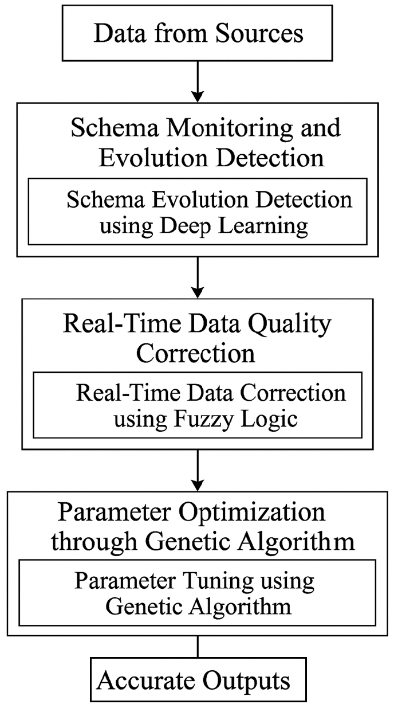

# Paper Analysis: AI-Guided Schema Evolution and Real-Time Data Quality

## Paper at a glance

The paper proposes a multi-source data-pipeline design with three cooperating stages:

1. **Schema monitoring:** learn expected record structure and detect changes.
2. **Quality correction:** use fuzzy rules to handle missing, inconsistent, or out-of-range values.
3. **Parameter tuning:** use a genetic algorithm (GA) to optimize correction parameters.

The intended outcomes are better accuracy, completeness, adaptability, and per-record latency. The paper reports 96.8% accuracy, 94.3% completeness, 92.1% adaptability, and 12 ms latency, compared with 93.4%, 87.2%, 81.9%, and 16 ms for its stated Johnson (2025) baseline.

## Architecture

The diagram presents a sequential flow from source data through schema detection, quality correction, and GA tuning to accurate outputs. The prose also describes some stages as simultaneous or parallel. That distinction needs to be resolved in an implementation and measured rather than assumed.

## Section-by-section reading

### Introduction and problem framing

The motivation is credible: sources evolve independently, data can be malformed or incomplete, and manual schema maintenance does not fit continuously operating pipelines. The paper identifies schema inconsistency, schema evolution, low quality, manual intervention, and real-time constraints. The problem statement and proposed combination of learning plus correction are understandable, but operational requirements such as event ordering, source isolation, and rollback are not specified.

### Literature review

The review summarizes 11 works and contrasts them in Table I across focus, strength, limitation, and real-time support. It positions the proposed system as a general-purpose combination rather than a replacement for any one prior system. The comparison table is useful as orientation, but the entries do not cite evidence for every characterization, and the cited sources are not benchmarked under a common experimental setup.

### Proposed methodology

- **Schema detection:** Algorithm 1 compares an incoming structure with an expected structure and replaces the stored schema on mismatch. The paper does not define the neural network inputs, architecture, training labels, confidence threshold, drift window, or how false positives and gradual drift are handled. A single atypical record could therefore trigger an update.
- **Fuzzy correction:** Algorithm 2 applies a rule when a field is missing or inconsistent. The rules, membership functions, defuzzification method, field-specific context, and uncertainty handling are not provided. Filling a value is not always safer than preserving a null or quarantining the record.
- **Genetic optimization:** Algorithm 3 describes selection, crossover, and mutation. It does not define the chromosome, fitness equation, validation data, stopping criteria, or how tuning avoids overfitting or adding latency to the live path.
- **Integration:** The section claims real-time processing and the figure implies serial stages, while later discussion attributes low latency to parallel processing. The execution model and where tuning runs need a precise definition.

### Simulation and results

The setup names Python 3.10, TensorFlow, SciKit-Fuzzy, DEAP, an Intel i7/32 GB/RTX 3080 machine, and UCI/Kaggle as dataset sources. It does not identify exact datasets or versions, record counts, source splits, injected corruption, train/test separation, workload rate, warm-up, repeated trials, or uncertainty intervals. No implementation, configuration, or raw results are included in the supplied text.

Metrics are introduced, but the definitions need tightening. Completeness divides fields filled by fields initially missing, so it does not show whether the filled values were correct. Accuracy is not operationally defined. Adaptability counts changes handled but does not define what qualifies as a schema change or successful handling. Latency lacks a measurement boundary and percentile reporting. The result tables give point estimates only; they do not establish that the improvement is statistically or operationally significant.

The reported values and comparisons should therefore be treated as **claims made by the paper**, not independently reproduced findings. In particular, the latency improvement and the reported baseline numbers need traceable benchmark evidence before they can support deployment decisions.

### Conclusion

The conclusion restates the proposed combination and suggests broader domains, GPU tuning, explainability, feedback, and cross-domain testing. These are reasonable directions, but the first priority should be a reproducible baseline and explicit safety behavior for uncertain corrections.

## Main strengths

- Addresses two related pipeline concerns: structural drift and record-level quality.
- Presents a comprehensible end-to-end architecture and pseudocode.
- Names practical evaluation dimensions: accuracy, completeness, adaptability, and latency.
- Recognizes that correction parameters may need to vary by data type or source.

## Main gaps and risks

- The paper does not provide enough implementation detail to reproduce the deep model, fuzzy inference system, or GA.
- Immediate schema replacement can mistake a bad or rare record for a permanent evolution event.
- Automatic imputation can create plausible-looking but incorrect data; provenance and confidence are absent.
- The GA's fitness target and interaction with live latency are unspecified.
- Experimental data, workload, measurement procedure, repetitions, and raw results are missing.
- Baselines are described from literature but are not shown to have been reimplemented or evaluated on identical data.
- The figure's serial pipeline conflicts with claims of parallel processing.
- The listed references should be verified for bibliographic accuracy and availability before publication; several entries lack complete venue or publication details.

## Implementation interpretation

The project now implements a practical version of all three proposed stages: a two-hidden-layer scikit-learn MLP trained from baseline schemas and synthetic mutations, a Mamdani fuzzy inference engine for confidence-scored corrections, and a DEAP genetic algorithm that tunes sensitivity/confidence on synthetic calibration examples. Schema changes require repeated observations before in-memory promotion; low-confidence value changes abstain and are marked for review.

This is not an exact reproduction of the paper: the paper does not specify a neural architecture, membership functions, GA fitness, or train/test protocol. The system currently provides local JSONL processing and seeded synthetic comparisons against no-op and static-rule baselines. Synthetic measurements do not validate production-domain performance, and the paper's reported metrics remain unverified. See [implementation_plan.md](implementation_plan.md) for the remaining domain-data, operational, and deployment work.
